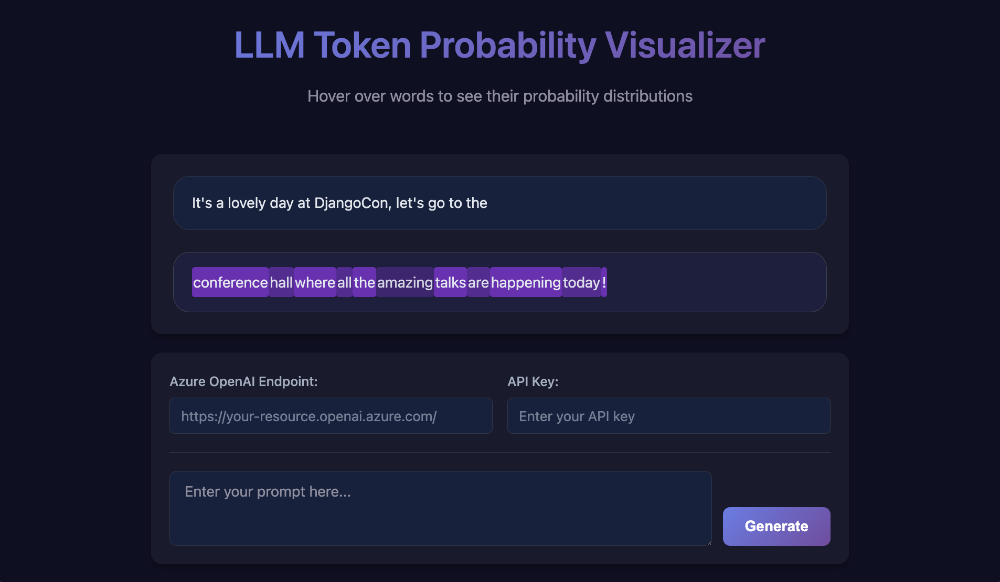

# Token Probability Visualizer

A Flask web application and Jupyter notebook for visualizing LLM token probabilities with interactive hover tooltips.

## Origin and attribution

This project began as a fork of [marlenezw/token-probability](https://github.com/marlenezw/token-probability) and has been substantially expanded with new visualization modes, hallucination-path analysis, multilingual support, configurable prompt templates, and automated tests. Terms are available in the [LICENSE](LICENSE) file.



## 🚀 Quick Start

### Live Demo (GitHub Pages)
Visit the [live demo](https://marlenezw.github.io/token-probability) to choose a visualization mode and explore the static demonstration.

### Local Development (Full Functionality)
For live token probability analysis with OpenAI:

1. **Clone the repository**
   ```bash
   git clone https://github.com/evellyncosta/ai-visualizer-swiss-knife.git
   cd ai-visualizer-swiss-knife
   ```

2. **Install dependencies**
   ```bash
   pip install -r requirements.txt
   ```

3. **Configure OpenAI (and, optionally, the Image Visualizer)**
   ```bash
   cp .env.example .env
   ```
   Edit `.env` and set `OPENAI_API_KEY` to your OpenAI API key. This key stays on the server and is never entered in the browser.

   To enable Image Visualizer, also set `HF_IMAGE_ENDPOINT_URL` to the deployed Hugging Face Inference Endpoint URL and, when required, `HF_TOKEN`. The server uses `huggingface_hub.InferenceClient.text_to_image()` and returns the generated image as PNG to the browser.

   `HF_IMAGE_ENDPOINT_URL`, `HF_TOKEN`, and all provider credentials must remain in server environment configuration; never put them in browser JavaScript, static-site configuration, or client requests.

4. **Run the Flask app**
   ```bash
   python app.py
   ```

5. **Open your browser**
   Navigate to `http://localhost:5000`

## 🌟 Features

- **Interactive Visualization**: Click each token to inspect its next-token probability table
- **Token Construction**: See how one predicted word can be assembled from multiple tokens
- **Context Tokenization**: See how the configured generation model segments the text you submitted
- **Live API Integration**: Connect to OpenAI for real-time token probability analysis
- **Responsive Design**: Works on desktop and mobile devices
- **Demo Mode**: GitHub Pages deployment with sample data for demonstration
- **Mode Selection**: Start at a home page and choose token visualization or complete-text visualization
- **Image Visualizer**: Generate, display, and download a PNG or JPEG returned by a server-configured endpoint

## 🛠️ How It Works

### Local Environment
- Full Flask backend with `/api/generate` endpoint
- Real-time API calls to OpenAI using server-side environment configuration
- Live token probability analysis
- Complete interactivity

Open `http://localhost:5000` to select a mode. `Visualizar token` opens with no example context or generated result; enter a context to begin. `Visualizar texto` accepts a question or instruction and shows the complete plain-text response token by token; paragraphs are allowed and Markdown is not.

The visualizer predicts one next word at a time. A word is not necessarily one token: select each displayed token to see the alternatives the model considered at that step. The table shows only the top candidates, so their probabilities do not necessarily sum to 100%.

The context is tokenized on the server using the official tokenizer encoding resolved for the same model used to generate the word. The display covers only the text you submit; it does not claim to show the provider's internal message envelope or system prompt tokens. Tokenizer configuration and API credentials remain server-side.

### GitHub Pages Demo
- Static HTML/CSS/JS deployment
- Pre-loaded sample responses
- Interactive visualization with demo data
- No backend required

## 📁 Project Structure

```
├── app.py                 # Flask application
├── templates/
│   ├── index.html        # Mode-selection page
│   ├── tokens.html       # Token visualizer
│   └── text.html         # Complete-text visualizer
├── static/
│   ├── style.css         # Styles
│   ├── script.js         # Original JavaScript (for local)
│   └── script-static.js  # Static version (for GitHub Pages)
├── requirements.txt      # Python dependencies
├── generate_static.py    # Static site generator
└── .github/workflows/
    └── deploy-to-pages.yml # GitHub Actions deployment
```

## 🔧 Technical Details

- **Backend**: Flask with CORS support
- **Frontend**: Vanilla JavaScript with CSS Grid/Flexbox
- **API**: OpenAI Chat Completions with logprobs enabled
- **Deployment**: Dual-mode (local Flask + static GitHub Pages)

## 🤝 Contributing

1. Fork the repository
2. Create a feature branch
3. Make your changes
4. Test locally
5. Submit a pull request

## 📝 License

See LICENSE file for details.
